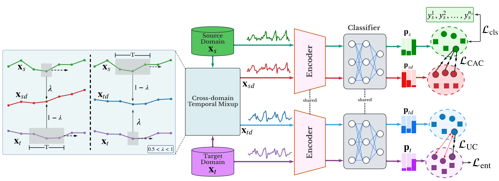
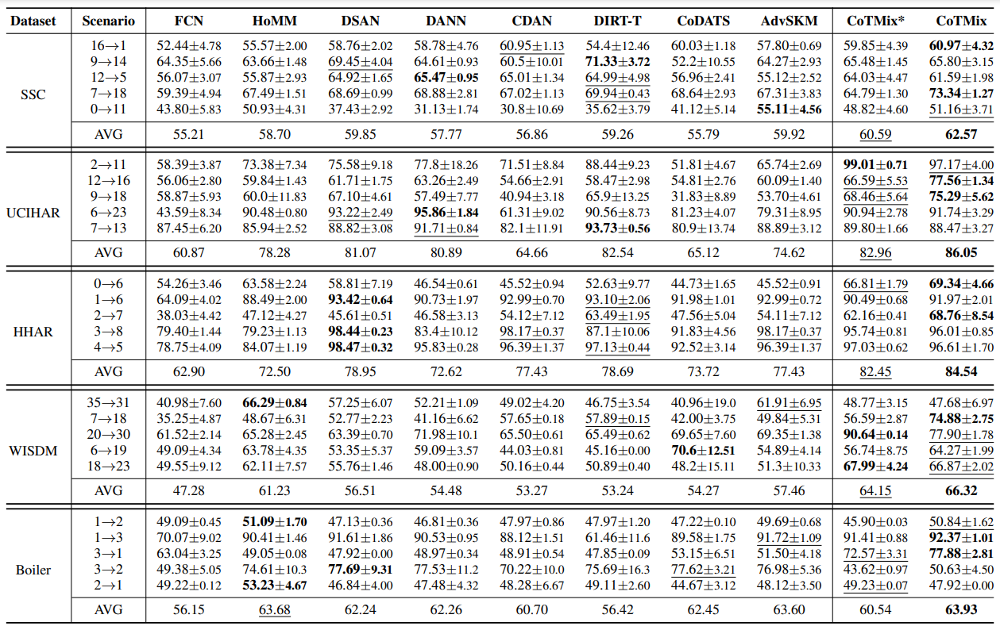

# CoTMix:  Contrastive Domain Adaptation for Time-Series via Temporal Mixup [[Paper](https://arxiv.org/abs/2212.01555)] [[Cite](#citation)]

### This work has been accepted for publication in the [IEEE Transactions on Artificial Intelligence (TAI).](https://ieeexplore.ieee.org/document/10177231)

### The code and the experimental datasets are adopted from [AdaTime framework](https://github.com/emadeldeen24/AdaTime)

## Cập nhật: thay backbone bằng DINOv3

Phiên bản này thêm backbone **DINOv3** (ViT, Hugging Face) để thay cho CNN 1D gốc. Các chỗ đã cập nhật so với repo gốc (tìm chú thích `[DINOv3]` trong code):

| File | Thay đổi |
|---|---|
| `models/dinov3_backbone.py` (**mới**) | Lớp `DINOv3(configs)`: STFT → log-spectrogram → conv 1x1 (C→3 kênh) → resize → DINOv3 (token CLS) → Linear về đúng `final_out_channels * features_len`. |
| `models/models.py` | **Cần thêm 1 dòng** ở đầu file: `from models.dinov3_backbone import DINOv3` (để `get_backbone_class("DINOv3")` tìm thấy lớp). |
| `main.py` | `--backbone` nhận thêm `DINOv3`; thêm 3 tham số `--dinov3_model`, `--dinov3_finetune`, `--dinov3_img_size`. |
| `trainer.py` | Trong `__init__`, gán 3 tham số DINOv3 vào `dataset_configs`. |
| `utils.py` | `copy_Files` sao lưu thêm `dinov3_backbone.py`. |
| `algorithms.py`, `dataloader.py` | **Không đổi**: đầu ra backbone giữ nguyên số chiều nên CoTMix và `calc_dev_risk` chạy như cũ. |

### Cài đặt và chạy
```bash
pip install transformers   # cần bản có hỗ trợ DINOv3
huggingface-cli login      # weights DINOv3 là gated: cần đồng ý điều khoản trên trang model
python main.py --backbone DINOv3 --dataset HHAR --da_method CoTMix
python main.py --backbone DINOv3 --dinov3_finetune   # fine-tune thay vì đóng băng
```

Mặc định encoder DINOv3 được **đóng băng** (chỉ train bộ chuyển kênh, projection và classifier). Khi dùng `--dinov3_finetune`, nên giảm `learning_rate` trong `configs/hparams.py` vì Adam dùng chung một lr cho toàn mạng.

## Abstract
<p align="center">

</p>

Unsupervised Domain Adaptation (UDA) has emerged as a powerful solution for the domain shift problem via transferring the knowledge from a labeled source domain to a shifted unlabeled target domain. Despite the prevalence of UDA for visual applications, it remains relatively less explored for time-series applications. In this work, we propose a novel lightweight contrastive domain adaptation framework called *CoTMix* for time-series data. Unlike existing approaches that either use statistical distances or adversarial techniques, we leverage contrastive learning solely to mitigate the distribution shift across the different domains. Specifically, we propose a novel temporal mixup strategy to generate two intermediate augmented views for the source and target domains. Subsequently, we leverage contrastive learning to maximize the similarity between each domain and its corresponding augmented view. The generated views consider the temporal dynamics of time-series data during the adaptation process while inheriting the semantics among the two domains. Hence, we gradually push both domains towards a common intermediate space, mitigating the distribution shift across them. Extensive experiments conducted on five real-world time-series datasets show that our approach can significantly outperform all state-of-the-art UDA methods. 

## Results
<p align="center">

</p>

## Citation
If you found this work useful for you, please consider citing it.
```
@ARTICLE{cotmix,
  author={Eldele, Emadeldeen and Ragab, Mohamed and Chen, Zhenghua and Wu, Min and Kwoh, Chee-Keong and Li, Xiaoli},
  journal={IEEE Transactions on Artificial Intelligence}, 
  title={Contrastive Domain Adaptation for Time-Series Via Temporal Mixup}, 
  year={2024},
  volume={5},
  number={4},
  pages={1185-1194},
  doi={10.1109/TAI.2023.3293473}
}
```

## Contact
For any issues/questions regarding the paper or reproducing the results, please contact me.   
Emadeldeen Eldele   
School of Computer Science and Engineering (SCSE),   
Nanyang Technological University (NTU), Singapore.   
Email: emad0002{at}e.ntu.edu.sg